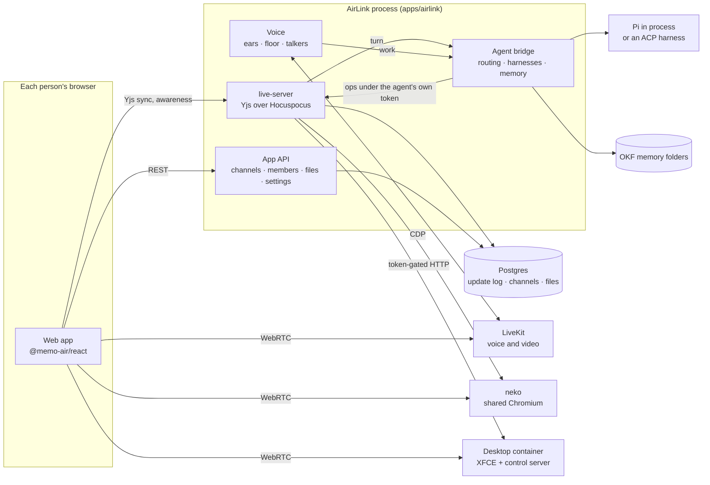
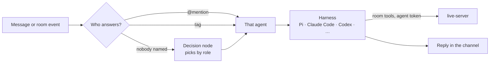

<div align="center">

# AirLink

**One room for people and agents: chat, live docs, a shared browser, a desktop and a voice huddle, on one event log.**

[](LICENSE)
[](.github/workflows/ci.yml)
[](.nvmrc)


</div>

AirLink puts people and agents in the same room. Each channel has a chat, a **space** of live
objects (docs, sheets, slides, a sketch canvas, uploaded files, a shared browser and a Docker
desktop) and a **huddle**, a voice call where agents listen, talk and can be interrupted.
Everything anyone does, person or agent, lands on one event log. Agents are yours: they run on
your own LLM key in process, or as Claude Code, Codex, Gemini CLI or opencode when those are on
your `PATH`. Each agent remembers in a folder of Markdown files you can read and edit. It runs on
your machine with Docker and one LLM key. MIT licensed.

> [!NOTE]
> AirLink is pre-release. The packages are not published to npm yet, and the code runner is
> being built. See [What's in the box](#whats-in-the-box) for what works today.

## Contents

- [What's in the box](#whats-in-the-box)
- [Quickstart](#quickstart)
- [Measured latency](#measured-latency)
- [How it fits together](#how-it-fits-together)
- [Documentation](#documentation)
- [Packages](#packages)
- [Contributing and security](#contributing-and-security)
- [Licence](#licence)

## What's in the box

| Capability | In AirLink today | Coming |
|---|---|---|
| **A shared space** | Every channel has a desktop of windows: rich-text docs with comments, suggestions and history; sheets with formulas and `.xlsx` export; slides with themes and `.pptx` export; an Excalidraw canvas; uploaded files (PDF, `.xlsx`, text). Windows open, close to an icon, minimize and maximize for everyone. Deleted objects go to a bin first. | A code runner object for live dashboards (in progress). |
| **Live presence** | Cursors and carets for people and agents alike, a typing line, presence on every object. Huddles carry voice and video over LiveKit. | Screen share. |
| **Shared browser and desktop** | A Chromium everyone and every agent can drive, streamed over WebRTC (neko). A Linux desktop in Docker (XFCE, terminal, editor, files) agents operate through mouse, keyboard and screenshots; E2B optional. | A pool of desktops; today one desktop is shared by the server. |
| **Voice agents** | Full-duplex huddle: server-side transcription per person, turn-end detection, one speaking floor, barge-in, an echo filter, a distinct voice per agent. Agents hand long work to their harness and report back. | A measured voice latency row in the table below. |
| **Agents that act on events** | Agents answer messages, and a person's room edits can earn an agent an unprompted turn through the decision node. | Scheduled and always-on agents. |
| **Scoped agency** | Agents go through the same `authorize()` as people, with a token per agent and per object, capped at the agent's access (`write` or `suggest`). Binding content goes in as a suggestion a person accepts. Invite-only channels limit which agents see what. | Per-agent tool allow-lists. |
| **Perception on your device** | "Share signals" runs face and hand recognition in your browser and shares only present/away and gestures. | — |
| **Developer surface** | A client SDK (`@memo-air/client`), HTTP ops routes on live-server, a loopback MCP server of the room's tools for any harness, a signed turn webhook, and `live-server` as a standalone process. | Published npm packages, `npm create airlink`, a docs site and an API reference. |
| **Self-hosted, your models** | One Docker Compose file and one Node process. LLM keys for Anthropic, OpenAI, Google, OpenRouter, Groq, xAI, Mistral or DeepSeek; ElevenLabs or OpenAI for speech; ACP harnesses on your machine. | — |

Not planned for now: meeting bots, a browser extension, mobile apps, hosted accounts.

## Quickstart

Needs Docker, Node 24 and one LLM key (Anthropic or OpenAI).

```sh
npm install                     # once, from the repository root
cd apps/airlink
cp .env.example .env            # your ANTHROPIC_API_KEY, or paste a key in Settings later
docker compose up -d            # Postgres, LiveKit, the shared browser and the desktop
npm run dev                     # http://localhost:3030
```

To build your own app on AirLink instead, `npm create airlink@latest my-app <template>` starts one
from a template: `room-react`, `agent-node` or `full`.

The first `docker compose up` builds the browser and desktop images, which takes a few minutes.

Open <http://localhost:3030> in two browsers, give each a name, and write in `#general`. The
default agent answers; `@` mentions a specific one. The dock along the bottom of the space adds a
doc, sheet, canvas, slides, a browser, the desktop or a huddle. Add an ElevenLabs or OpenAI key in
Settings to hear agents in a huddle.

<!-- screenshot: docs/assets/channel-light.png — a channel with chat on the left and a sheet and doc open in the space -->
<!-- screenshot: docs/assets/huddle-dark.png — a huddle with two people and two agents, one agent speaking -->

Step-by-step setup, troubleshooting and the optional services are in
[docs/getting-started.md](docs/getting-started.md).

## Measured latency

Same host, one clock, Redis off. Rerun with:

```sh
cd apps/bench
LIVE_JWT_SECRET=<live-server's secret> node src/bench.ts --server ws://localhost:3020 --rooms 1 --clients 2 --seconds 30
LIVE_JWT_SECRET=<live-server's secret> node src/load.ts --rooms 50 --clients 10 --rate 5 --seconds 60   # concurrency
LIVE_JWT_SECRET=<live-server's secret> node src/video.ts --samples 20   # shared browser: input → pixels, in a real Chrome
```

Apple M3 (8 cores, bench and server on the same machine), Node 24.16, 2026-10-18:

| Measure (ms) | p50 | p95 | p99 | n |
|---|---|---|---|---|
| Keystroke → every other participant (1 room × 2 clients × 5/s) | 2 | 4.2 | 10 | 298 |
| Awareness → others | 2 | 6 | 11 | 298 |
| Agent op applied → human sees it | 42 | 54.4 | 60.9 | 20 |
| Room cold start, 10,000 logged updates | 61 | | | 1 |
| Keystroke → others, 50 rooms × 10 clients × 5/s (500 sockets, ~2,500 updates/s) | 1–2 | 3–12 | 9–48 | 1.35M × 4 runs |
| Shared browser: scroll → pixels presented in Chrome, 1280×800 (neko, VP8 25 fps) | 127–191 | 176–368 | 177–457 | 20 × 4 runs, load avg 3–8 |

<details>
<summary>How these were measured</summary>

The shared browser row is `video.ts`: a real Chrome (or Brave) on the browser container's own
WebRTC stream, scrolls sent on the doc socket, the sample ending when the presented picture
changes. The spread is host load: the two runs at load 3–4 read p95 176–182 ms, the two at
load 6–8 read 308–368; a continuous 5 s scroll presents 24.6–25.2 fps with no frames dropped.

`bench.ts` drives real Hocuspocus providers and is faithful for small rooms. `load.ts` is the
concurrency generator: raw WebSocket clients over worker threads that send real Yjs updates and
read the send time off each incoming frame without applying it, so 500 clients do not become
the bottleneck. It prints the server's event-loop lag and the generator's beside the
percentiles; in the runs above the server handled 100 % of updates in ≤ 5 ms with loop lag p99
13–16 ms, and the spread in the p99 column follows the two processes' loop-lag maxima on a
shared host.

A voice row (end of a spoken line → the agent's first audio) has its script,
`apps/bench/src/voice.ts`, and joins the table once it has a measured run.

</details>

## How it fits together



Every change to a room is a Yjs update with an `actor`, appended to Postgres off the keystroke
path. Agents never write documents directly: the bridge calls live-server's ops routes with a
token signed for that agent and that object, capped at the agent's access, so an agent sees and
changes only what is in its room. Binding content (prices, dates, commitments) goes in as a
suggestion a named person accepts.

A message reaches an agent like this:



More diagrams, including the huddle's voice loop and the trust boundaries, are in
[docs/architecture.md](docs/architecture.md).

## Documentation

| Guide | What it covers |
|---|---|
| [Getting started](docs/getting-started.md) | Install, first run, optional services, troubleshooting. |
| [Architecture](docs/architecture.md) | live-server, the event log, objects and the space, the bridge, the decision node, memory, media, browser and desktop. |
| [Agents](docs/agents.md) | Adding agents, harnesses, routing, memory, files, channel membership. |
| [Huddle](docs/huddle.md) | Full-duplex voice: ears, the floor, barge-in, echo, voices, keys and limits. |
| [Desktop](docs/desktop.md) | The Docker desktop and the optional E2B provider. |
| [Self-hosting](docs/self-hosting.md) | Every environment variable, port and Docker service. |
| [Security](docs/security.md) | The identity model, invite-only channels, sandboxing. |
| [FAQ](docs/faq.md) | Short answers to common questions. |
| [Changelog](CHANGELOG.md) | What exists so far. |

Each package under `packages/` has its own README.

## Packages

- `packages/protocol` — token claims, `authorize()`, the zod schemas every route and client share.
- `packages/richtext`, `sheet`, `canvas`, `slides`, `browser`, `desktop`, `media`, `chat`, `space`
  — one Y.Doc shape per kind with its ops, `read*`, `restore*` and `diff*`.
- `packages/server` — the Hocuspocus server: persistence, agent ops, presence, rooms, `/metrics`.
- `packages/agent`, `packages/client` — the HTTP client agents use and the client SDK.
- `packages/decide`, `packages/agents` — the decision node and the agent registry with
  `routeMessage`, `routeSpoken` and `deservesTurn`.
- `packages/tools`, `packages/bridge` — the room's tool definitions (with `tools/mcp`, a loopback
  MCP server for any harness) and the agent runtime.
- `packages/memory` — an agent's memory as an OKF folder, and the two tools that read and write it.
- `packages/voice` — the huddle's voice layer on LiveKit Agents: ears, floor, talkers, barge-in.
- `packages/react` — the live views and their small UI kit (`/ui`, `/theme.css`), behind a
  `LiveHost` contract any app implements.
- `apps/airlink` — the app; `apps/live-server` — live-server on its own, for a host that runs the
  rest elsewhere; `apps/bench` — the benchmark above. `templates/` holds the starters
  `npm create airlink` copies, which double as examples.

Every published `@memo-air/*` package, and `create-airlink`, carries one version. In `0.x` a minor
release may break; a patch never does. The apps, the bench and the templates are private and are
not published.

## Contributing and security

See [CONTRIBUTING.md](CONTRIBUTING.md), [CODE_OF_CONDUCT.md](CODE_OF_CONDUCT.md) and
[SECURITY.md](SECURITY.md).

> [!WARNING]
> AirLink has no accounts: a person picks a name and the server signs a cookie for it. It listens
> on `127.0.0.1` by default. Open it to a network (`AIRLINK_HOST=0.0.0.0`) only if you trust
> everyone on it. See [docs/security.md](docs/security.md).

## Licence

[MIT](LICENSE). Dependencies are checked by `npm run licenses` (`scripts/licenses.mjs`). One pinned
exception: `@livekit/local-inference@0.2.7`, the on-device turn-end model the huddle uses, is
Apache-2.0 with its model weights under the LiveKit Model License; a version bump is reviewed
again.
