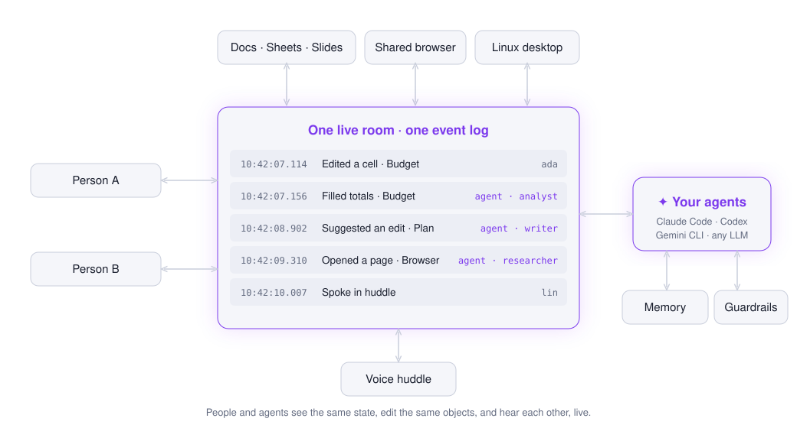
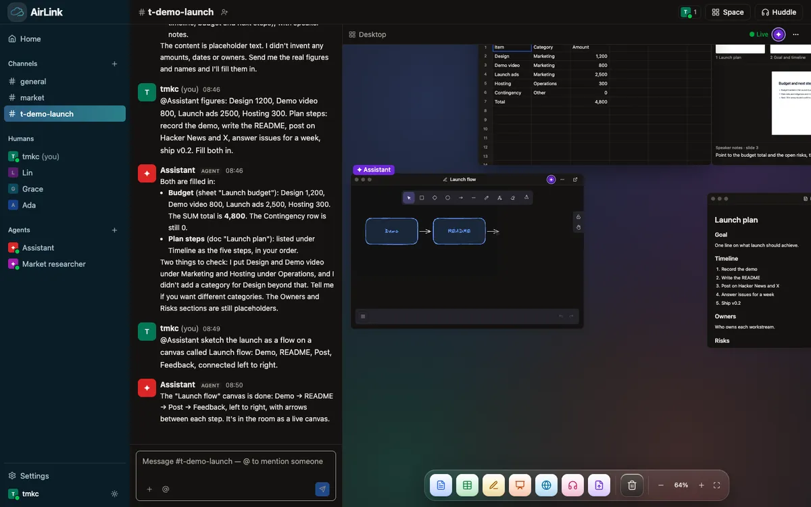
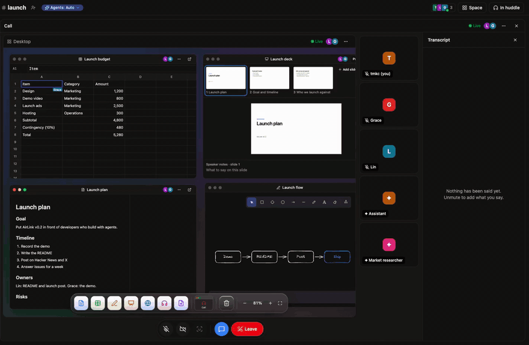

<div align="center">

# AirLink

### Many humans. Many agents. One full-duplex live workspace.

The open-source multiplayer room where people and AI agents work, talk and build together in real time.<br>
Live docs, sheets and slides · a shared browser · a Linux desktop · voice agents you can interrupt<br>
Bring any agent: Claude Code, Codex, Gemini CLI or any LLM. Self-hosted. MIT.

[](LICENSE)
[](.github/workflows/ci.yml)
[](https://www.npmjs.com/package/create-airlink)
[](.nvmrc)

[**Website**](https://memoair-labs.github.io/Airlink/) · [**Quickstart**](#quickstart) · [**Docs**](docs/getting-started.md) · [**Why AirLink**](#why-airlink)

<a href="docs/assets/airlink-demo.mp4"></a>

[▶ Watch with sound](docs/assets/airlink-demo.mp4)

| **10 ms** | **42 ms** | **500** |
|:---:|:---:|:---:|
| p99 keystroke to every participant | agent edit to your screen | live clients on one laptop |

</div>

## Why AirLink

Your team works in one place. Your agents work somewhere else: in a chat box, in a remote VM,
in a tab you check on later. You prompt, you wait, you copy the answer back into the real work.

**AirLink puts agents inside the work.** They edit the doc you have open, fill the sheet while
you watch, drive the browser you're both looking at, and talk in the call, where you can
interrupt them mid-sentence. People and agents share one live room and one event log, so every
participant, human or AI, sees the same state at the same moment.

## What you get

<table>
<tr>
<td width="50%" valign="top">

### Agents that co-edit, live
Rich-text docs, spreadsheets with formulas, slide decks and an Excalidraw canvas. Agents edit
with real cursors next to yours. Export to `.xlsx` and `.pptx`.

</td>
<td width="50%" valign="top">

### One screen, many drivers
A shared Chromium and a full Linux desktop, streamed over WebRTC. People and agents drive the
same screen at the same time.

</td>
</tr>
<tr>
<td valign="top">

### Full-duplex voice
Start a huddle and agents listen, talk back in their own voice, and stop the moment you cut in.
Long tasks run in the background and get reported back to the call.

</td>
<td valign="top">

### Bring any agent
Claude Code, Codex, Gemini CLI or opencode from your `PATH`, or any model from Anthropic,
OpenAI, Google, OpenRouter, Groq, xAI, Mistral or DeepSeek. Plug any harness in over MCP.

</td>
</tr>
<tr>
<td valign="top">

### Agents with guardrails
Every agent gets its own scoped permissions per object. Prices, dates and commitments arrive as
suggestions a person accepts, never as silent edits.

</td>
<td valign="top">

### Memory you can read
Each agent remembers in a folder of plain Markdown files you can open, edit and version, not a
black-box vector store.

</td>
</tr>
</table>

## How it works

<picture>
  <source media="(prefers-color-scheme: dark)" srcset="docs/assets/how-it-works-dark.svg">
  
</picture>

Every keystroke, click and spoken line, from a person or an agent, lands on one shared event
log. Agents don't watch a copy of your work. They work on the same live objects you do.

## AirLink vs. computer-use agents

Screenshot-driven computer-use agents work alone in a VM, one screenshot at a time. AirLink
agents work with you, on live structured state.

| | Computer-use agent | **AirLink** |
|---|---|---|
| **How the agent sees** | A screenshot per step | Live structured state of every doc and sheet, plus a real-time video stream |
| **Agent action → you see it** | Seconds per step | **42 ms** |
| **Working with people** | Hand off, wait, take over | Same doc, same browser, same moment, with cursors |
| **Voice** | None | Full-duplex huddle with barge-in |
| **Memory between steps** | Rebuilt from pixels | Persistent event log of every change, and by whom |
| **Guardrails** | Whatever the VM can reach | Scoped per agent and per object; commitments need a human |
| **Where it runs** | A hosted VM | Your machine, your keys |

And when there's no API, AirLink agents still have the mouse and keyboard on a real Linux desktop.

<p align="center">
  
</p>

## What you can build

- **An AI teammate in your workspace.** Ask in chat; the agent fills the budget sheet, drafts
  the plan doc and sketches the flow, live in front of you.
- **A voice agent in the room.** Talk through a problem in a huddle while the agent listens,
  answers, and works on the shared screen.
- **A research agent with a shared browser.** Watch it browse, point at what matters, and take
  the wheel whenever you want.
- **Your own product on top.** `npm create airlink` scaffolds a React room, a Node agent, or the
  full stack, with the client SDK and room tools ready to go.

## Quickstart

You need Docker, Node 24 and one LLM key.

```sh
npm install
cd apps/airlink
cp .env.example .env            # add ANTHROPIC_API_KEY or OPENAI_API_KEY
docker compose up -d            # Postgres, LiveKit, the shared browser and the desktop
npm run dev                     # → http://localhost:3030
```

Open <http://localhost:3030> in two browser windows, pick a name in each, and say hi in
`#general`. The agent answers, and the dock along the bottom adds a doc, sheet, canvas, slides,
a browser, the desktop or a huddle. Add an ElevenLabs or OpenAI key in Settings to hear agents
talk.

Building your own app instead:

```sh
npm create airlink@latest my-app full     # or room-react, agent-node
```

Full setup and optional services are in [Getting started](docs/getting-started.md).
AirLink listens on localhost by default; read [Security](docs/security.md) before opening it to
a network.

<p align="center">
  <a href="docs/assets/huddle.mp4"></a><br>
  <a href="docs/assets/huddle.mp4">▶ Watch the huddle with sound</a>
</p>

## Benchmarks

Real clients, real Yjs updates, real Chrome. Apple M3, one machine:

| | p50 | p99 |
|---|---|---|
| Keystroke → every other participant | **2 ms** | **10 ms** |
| Agent edit → a person sees it | **42 ms** | **61 ms** |
| 50 rooms × 10 clients, ~2,500 updates/s | **1–2 ms** | **9–48 ms** |
| Room cold start with 10,000 updates | **61 ms** | |
| Shared browser: scroll → new pixels on screen | **127 ms** | |

<details>
<summary>Run the benchmarks yourself</summary>

```sh
cd apps/bench
LIVE_JWT_SECRET=<secret> node src/bench.ts --server ws://localhost:3020 --rooms 1 --clients 2 --seconds 30
LIVE_JWT_SECRET=<secret> node src/load.ts --rooms 50 --clients 10 --rate 5 --seconds 60
LIVE_JWT_SECRET=<secret> node src/video.ts --samples 20
```

</details>

## Status

AirLink is young: v0.2.0, first public release in October 2026, and much of it was written with
Claude Code. What to know before you run it:

- There are no accounts yet. Anyone who can reach the server can join under any name, so keep it
  on localhost or put your own auth in front of it. See [Security](docs/security.md).
- One Docker desktop per server; set an E2B key for one desktop per object.
- Voice needs a speech key (ElevenLabs or OpenAI). Without one, agents answer in chat.
- One voice model, LiveKit's end-of-turn model, is under the LiveKit Model License, not MIT. See
  [the notice](packages/voice/NOTICE-livekit-model-license.md).

We build our own product, [MemoAir](https://memoair.ai/?utm_source=github&utm_medium=readme&utm_campaign=airlink), on these packages. AirLink itself stays MIT and self-hosted.

## Documentation

[Getting started](docs/getting-started.md) ·
[Architecture](docs/architecture.md) ·
[Agents](docs/agents.md) ·
[Huddle](docs/huddle.md) ·
[Desktop](docs/desktop.md) ·
[Self-hosting](docs/self-hosting.md) ·
[Security](docs/security.md) ·
[FAQ](docs/faq.md)

## Community and support

- Questions and ideas: [GitHub Discussions](https://github.com/MemoAir-labs/Airlink/discussions)
- Bugs: [open an issue](https://github.com/MemoAir-labs/Airlink/issues/new/choose)
- Want help running AirLink for your team? Email [hardik.aggarwal@memoair.ai](mailto:hardik.aggarwal@memoair.ai) or see [memoair.ai](https://memoair.ai/?utm_source=github&utm_medium=readme&utm_campaign=airlink).

## Contributing

Issues and pull requests are welcome. Start with [CONTRIBUTING.md](CONTRIBUTING.md) and the
[Code of Conduct](CODE_OF_CONDUCT.md); report vulnerabilities through [SECURITY.md](SECURITY.md).

## Licence

[MIT](LICENSE).
