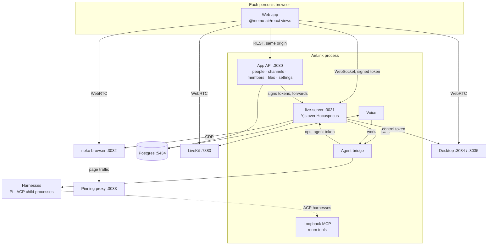
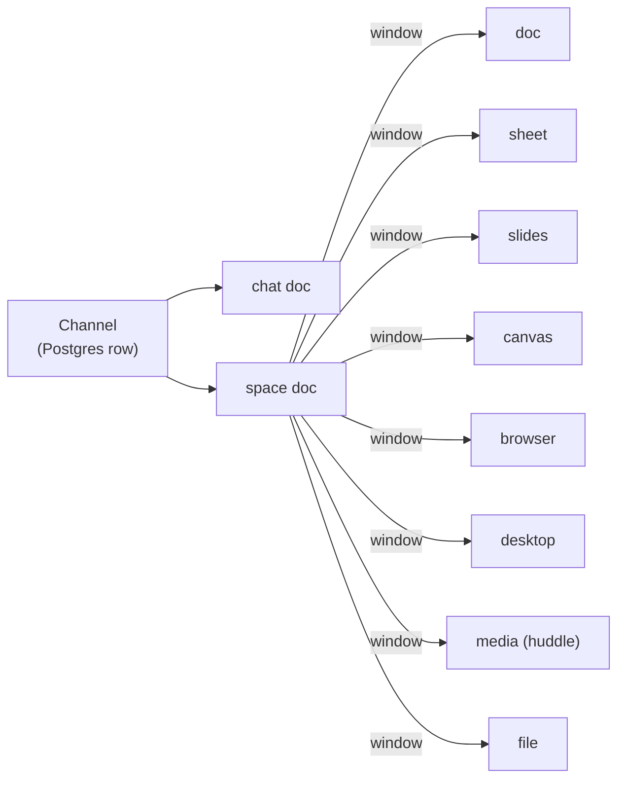
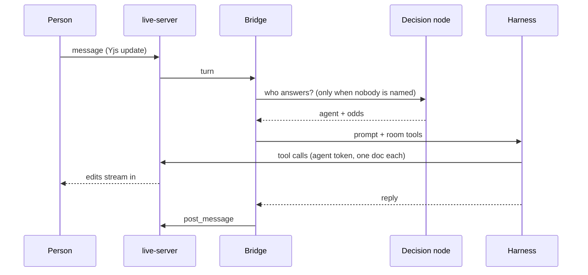

# Architecture

AirLink is one Node process (`apps/airlink/server/main.ts`) beside a few Docker services. Inside
the process: live-server, the agent bridge, the voice layer and the app's API with the web app.

## System

The process listens on `127.0.0.1` by default. live-server is also published as its own app,
`apps/live-server`, for a host that runs the rest elsewhere (see
[self-hosting.md](self-hosting.md#live-server-on-its-own)).

## live-server

`@memo-air/server` (`createLiveServer`) is a Hocuspocus server with:

- **Authorization.** Every connection and every HTTP route carries a token signed with the shared
  secret (`@memo-air/protocol/tokens`). Its claims name the actor (`human` or `agent`), the
  workspace, the one doc it is for and an access level. `authorize()` is the single check, for
  people and agents alike.
- **Persistence.** Each Yjs update is appended to `live_doc_updates` with its actor, batched off
  the keystroke path; `live_doc_snapshots` compacts them. A room cold start replays the log (61 ms
  for 10,000 updates, see the README).
- **The event log.** `live_events` records what happened (edits, messages, joins, signals) with
  the actor; `live_suggestions` holds pending binding changes; `live_decisions` every decision the
  decision node made.
- **Agent ops.** HTTP routes under `/v1/docs/:doc/…` (`ops`, `sheet-ops`, `canvas-ops`,
  `slides-ops`, `chat-ops`, `space-ops`, `browser-ops`, `desktop-ops`, `outline`, `history`,
  `restore`, `comments`, `transcript`, `media-token` and more) apply an agent's change through a
  direct connection, streamed in frames so people watch it happen.
- **Presence.** An agent's caret, cell or pointer is a synthetic awareness entry, drawn the way a
  person's is.
- **Turns.** A person's chat message is a turn at once. Other room events (an edit, once the
  person stops; a comment) are asked of the decision node: does this deserve an agent's turn? A
  yes goes to the host through `onTurn` in process, or `LIVE_TURN_HOOK_URL` over HTTP, signed.
- **Metrics.** `/metrics` (Prometheus) and `/healthz`.

Redis (`REDIS_URL`) is wired for multi-node but off; the measured table is with it off.

## Objects and the space

Each object is one Y.Doc with its own package: the shape, its ops, `read*` for agents,
`restore*` and `diff*` for history.

| Kind | Package | Holds |
|---|---|---|
| `chat` | `chat` | Messages with mentions, attachments and reactions. Never binding. |
| `space` | `space` | Every object placed as a window: position, size, state, who arranged it. |
| `doc` | `richtext` | Tiptap/ProseMirror blocks, comments, suggestions. Markdown export. |
| `sheet` | `sheet` | Cells, formulas (`fast-formula-parser`), column formats. `.xlsx` export. |
| `slides` | `slides` | Slides, elements, themes. `.pptx` export. |
| `canvas` | `canvas` | Excalidraw elements. |
| `browser` | `browser` | The shared browser's URL, title and visit history. |
| `desktop` | `desktop` | The desktop's status and action log. |
| `media` | `media` | The huddle's state and transcript. |
| `file` | (app) | An upload, stored as bytes in Postgres (`airlink_files`). |

A channel is a chat doc plus a space doc. Closing a window destroys nothing; it waits on the
desktop as an icon. A person can move an object to the bin and put it back; only emptying the bin
deletes it. An agent never moves or resizes a window a person arranged.

**Suggestions.** An agent with `suggest` access makes every change as a suggestion a person
accepts or rejects. In sheets, canvases and slides, an agent's change to something a person wrote
lands as a suggestion even with `write` access.

## The agent bridge

`@memo-air/bridge` (`createBridge`) is the agent runtime. For each turn it:

1. finds the channel's chat doc and which agents are members,
2. routes the turn (see [agents.md](agents.md#routing)),
3. builds a prompt with the event and the list of live objects in the room,
4. runs the chosen agent on its harness with the room's tools, its memory tools,
   `arrange_windows` and `read_live_file`,
5. posts the reply in the chat.

Turns run one at a time per agent per channel, in arrival order. Every tool call goes to
live-server under a token signed for that agent and that object, capped at the agent's access.

## The decision node

`@memo-air/decide` answers typed questions (`choice`, `score`, `noul`) with calibrated odds
and no prose. It is used for: which agent answers a message nobody named, whether a room event
deserves a turn, whether a memory is worth keeping, and which agent a spoken line is for.

AirLink's Settings choose the provider:

- **Model** (default): a small model on your key (`anthropic/claude-haiku-5-5`, else
  `openai/gpt-6-luna`) through `piDecide`.
- **System One**: any server speaking `POST /v1/systemone`. Two exist: Laya (Apache-2.0, 322M,
  CPU), served by the compose `decide` profile on port 8000
  (`docker compose --profile decide up -d`); and Jev (TypeSafe, by key). Laya measured
  near-uniform odds and 2.5–3.5 s a choice on a laptop, so it is the fine-tuning path, not a
  router yet.

With no provider, nothing is decided and every decision point falls through to its default. Every
decision lands in `live_decisions` with its probabilities and a hash of the state, so a local model
can later be tuned on the room's own traffic.

## Memory

An agent's memory is a folder of [OKF](https://agentic-ai.readthedocs.io/en/latest/Standards/open-knowledge-format/)
documents: Markdown with YAML frontmatter, `type` required. The folder is the whole store. See
[agents.md](agents.md#memory).

## Media and the huddle

LiveKit carries voice and video. live-server mints media tokens (`media-token`) and keeps the
transcript in the media doc. `@memo-air/voice`, in the AirLink process, joins each huddle with
a hidden listener per person and one voice participant per agent. See [huddle.md](huddle.md).

"Share signals" in a huddle runs MediaPipe face and hand recognition in the browser and sends only
present/away and gesture signals; no video leaves for this.

## The shared browser

A neko container runs Chromium and streams it over WebRTC (VP8, 1280×800). live-server drives it
over CDP for agents (`open_live_browser`, `read_live_browser`, `act_live_browser`) and reads the
page as an accessibility outline, not pixels. People take turns at input through an input mux.

Every page connection goes through AirLink's pinning proxy (port 3033), which resolves the address
itself and refuses private and internal ones.

## The desktop

A Linux desktop in Docker (neko's XFCE image) with a token-gated control server, or E2B by key.
One desktop is shared by the server at a time. See [desktop.md](desktop.md).

## The web app

`apps/airlink/web` is a React app on Vite. The live views come from `@memo-air/react`, which
asks its host for connections, tokens and data through the `LiveHost` contract, so another app can
draw the same views. In development Vite runs inside the server process on the same port.
