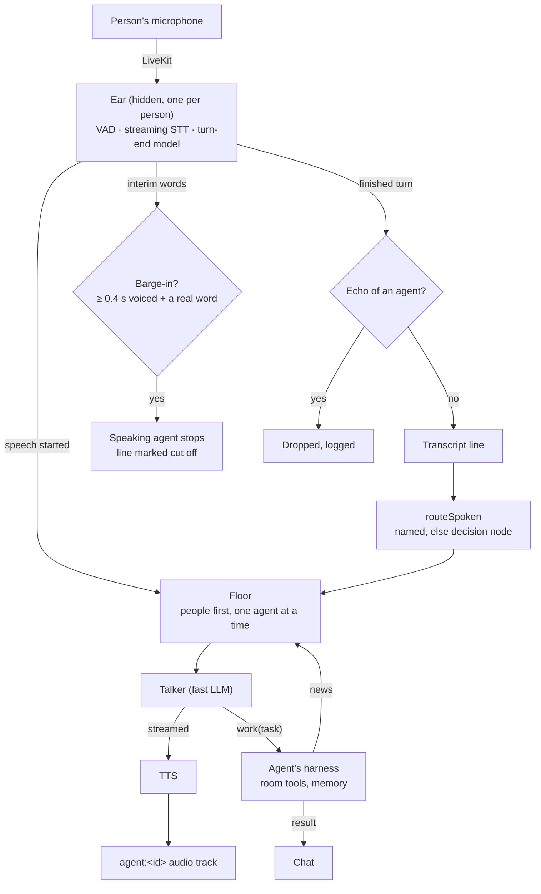

# Huddle: full-duplex voice

A huddle is a voice and video call in a channel. People talk to each other; agents listen, answer
when they are addressed, can be interrupted, and hand longer work to their harness while the call
goes on. The voice layer is `@memo-air/voice`, built on LiveKit Agents for Node (1.9.x).

## What you need

- LiveKit running (the compose `livekit` service, on by default).
- A **speech key**: ElevenLabs, Cartesia, Deepgram or OpenAI, used in that order when several are
  set. Set it in Settings or as `ELEVENLABS_API_KEY` / `CARTESIA_API_KEY` / `DEEPGRAM_API_KEY` /
  `OPENAI_API_KEY`. Without a speech key and a talker, AirLink blocks the huddle and points to
  Settings.
- A **talker**: the default model in Settings must be an Anthropic or OpenAI model with a key.
  The default, `anthropic/claude-haiku-5-5`, works with an Anthropic key.

Without these, the huddle still works for people. It shows "Agents answer this call in chat. Add an
ElevenLabs or OpenAI key in Settings to hear them." Each person can turn on "Transcribe me"
(ElevenLabs Scribe from the browser with a key, otherwise the browser's own speech service, which
Chrome, Edge and Safari have and Brave and Firefox do not), and agents named in those lines answer
in chat.

## The loop

### Ears

One hidden LiveKit participant per person (`ear:<identity>`) subscribes to that person's
microphone only, never to an agent's track. It runs voice activity detection, streaming
speech-to-text (ElevenLabs `scribe_v2_realtime` or OpenAI `gpt-4o-mini-transcribe`) and LiveKit's
on-device end-of-turn model (`@livekit/local-inference`). A turn ends when the model says so, with
endpointing between 700 ms and 2.5 s; quick consecutive lines from one person are one turn. Each
finished line is written to the huddle's transcript by the server, attributed to the speaker.

If the turn-end model is not available (first run offline), the ears fall back to a 700 ms silence
and log it.

### Routing

A line goes to the agents it names; else to the one agent the decision node is sure the line is for
by role (confidence ≥ 0.6); else to nobody, because most of a call is people talking to each other.
Routing that takes longer than 3 s is treated as "nobody". Only agents that are members of the
channel are considered.

### The floor

One per huddle:

- People can always speak. While anyone is talking, no agent starts.
- Agents speak one at a time, in order. Each hears what the previous one said.
- An agent's own news (its work finishing) waits for a free floor and 0.7 s of quiet.
- A newer turn addressed to an agent replaces its reply that has not started.

### Barge-in

A person stops a speaking agent by talking over it with at least 0.4 s of voice and one word that
is not a backchannel ("mm-hm", "yeah", "right", "okay" and the like do not count). The agent stops,
the rest of its reply is dropped, and the transcript marks the line "— cut off". The cut line is
context for whoever speaks next.

### Echo

Three layers keep an agent from hearing itself:

1. All agent speech is a LiveKit audio track, so each browser's echo canceller can remove it.
2. Ears never subscribe to agent tracks.
3. A person's line of three or more words that mostly (60 % of its words) matches what an agent
   said in the last 8 seconds is dropped and logged. This catches laptop speakers leaking past the
   echo canceller.

### Talker and worker

Each agent in a huddle gets a **talker**: the default model from Settings, prompted to talk like a
warm, concise colleague in one to three short sentences, with no lists or markdown. The talker has
one tool, `work(task)`. For anything that needs live objects, files, the browser or more than a
quick answer, it calls `work`, says in a sentence what it is doing, and frees the floor.

`work` runs the agent's own harness (Pi, Claude Code, …) through the bridge, exactly as a chat turn
does: same room tools, memory and membership, and the same queue as that agent's chat turns in the
channel. The full reply is posted in the chat; the talker then asks for the floor and sums it up
aloud.

If the talker or the speech provider fails, the harness answers in chat instead.

## Voices

- **Distinct by default.** Each agent gets a voice from the provider's catalog, picked from its id,
  so it stays the same across restarts and no two agents share one while voices remain.
- **Your choice.** Each agent's page has a voice picker with a preview and a speed from 0.8 to 1.2
  (saved as `voice.id` and `voice.speed` in `agents.json`).
- **ElevenLabs** uses `eleven_flash_v2_5` with conversational voice settings. **OpenAI** uses
  `gpt-4o-mini-tts` with a short tone instruction drawn from the agent's role.

## Limits and timings

| What | Value |
|---|---|
| Barge-in threshold | 0.4 s of voice + one non-backchannel word |
| News waits for quiet | 0.7 s |
| Routing gives up after | 3 s |
| One agent utterance, at most | 90 s, then it is stopped |
| An idle agent voice leaves after | 10 minutes |
| A person who drops is kept for | 15 s, to reconnect |
| An ear that fails to open | retries from 1 s up to 30 s, then gives up; the chat gets one notice |

Not yet:

- A measured latency row. The target is about 1–1.5 s from the end of a person's line to the
  agent's voice; `apps/bench/src/voice.ts` measures it and the row joins the README once it has a
  run.
- Agents reacting aloud to objects changing under them. Today an agent's own news is its work
  finishing.
- Agents interrupting people, video understanding, meeting bots, speech-to-speech models, and local
  speech models are out of scope for now.

## Keys and privacy

Speech is sent to the provider you chose (ElevenLabs or OpenAI) and the talker's text to your LLM
provider, on your own keys. Keys stay in `.airlink/settings.json` and never reach the browser; the
browser gets a single-use token for Scribe when "Transcribe me" is on.
