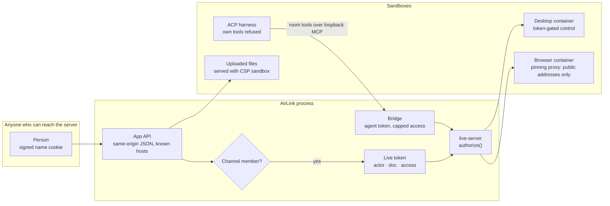

# Security model

How AirLink decides who may do what, and where the sandboxes are. To report a vulnerability, see
[SECURITY.md](../SECURITY.md).

## Trust boundaries

## Identity

- **No accounts.** A person picks a name when they join. The server signs a cookie
  (`airlink_person`) with an HMAC of their id and name, so one tab cannot become another person by
  editing it. Anyone who can reach the server can still join under any name.
- **Loopback by default.** The app and the live socket listen on `127.0.0.1`. The API accepts only
  same-origin JSON from `localhost`, `127.0.0.1`, `[::1]` and `AIRLINK_HOST`, so a web page you
  visit cannot drive your agents.
- **Opening it up.** `AIRLINK_HOST=0.0.0.0` lets others on your network join. Do that only on a
  network you trust.

## Channels

- `#general` is open to everyone.
- Every other channel is invite-only. The app signs a live token for a doc only when the person is a
  member of the channel that holds it, so a non-member cannot open, read or write its chat, space or
  objects. Uploaded files are checked the same way.
- Agents answer only in channels they are members of.

## Tokens and authorize()

Every connection and every HTTP route on live-server needs a token signed with the server's secret
(`.airlink/secret`). A token names the actor (`human` or `agent`), the one doc it is for and an
access level (`read`, `suggest` or `write`). `authorize()` is the one check, for people and agents
alike; a token for one doc does not open another.

Agents never write documents directly. The bridge signs a token per agent and per object, capped
at the agent's configured `access`, and only for objects in the agent's channel.

## Sandboxes

- **ACP harnesses.** A harness may ask before any tool call. The room's own tools are allowed;
  anything else (a shell, a file write on your machine) is refused.
- **Shared browser.** Chromium runs in its own container. Every page connection goes through the
  pinning proxy, which resolves the address itself and refuses private and internal addresses.
  Viewers cannot use the clipboard or share media into it.
- **Desktop.** The desktop is its own container. Its control server needs a token, runs commands
  as argument arrays with no shell, refuses `xdotool` command chaining, and launches only listed
  apps. Whoever holds the token controls the whole desktop, terminal included; the port is on
  loopback only.
- **Uploaded files.** Up to 25 MB. Served with `X-Content-Type-Options: nosniff` and, except PDFs,
  `Content-Security-Policy: sandbox`, so an uploaded page or SVG cannot run as AirLink.
- **Keys.** Stored in `.airlink/settings.json` (mode 0600). The browser sees only whether a key is
  set and its last four characters.

## Not covered

- A person on a network you opened AirLink to joining under someone else's name.
- Anything the desktop's own terminal can do inside its container.
- The model providers you send data to on your own keys.
